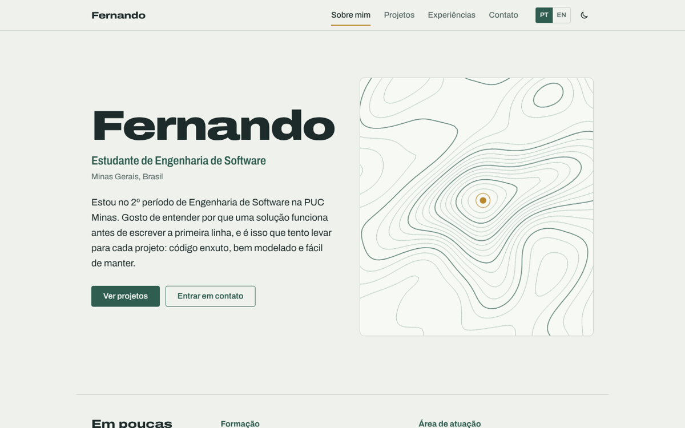
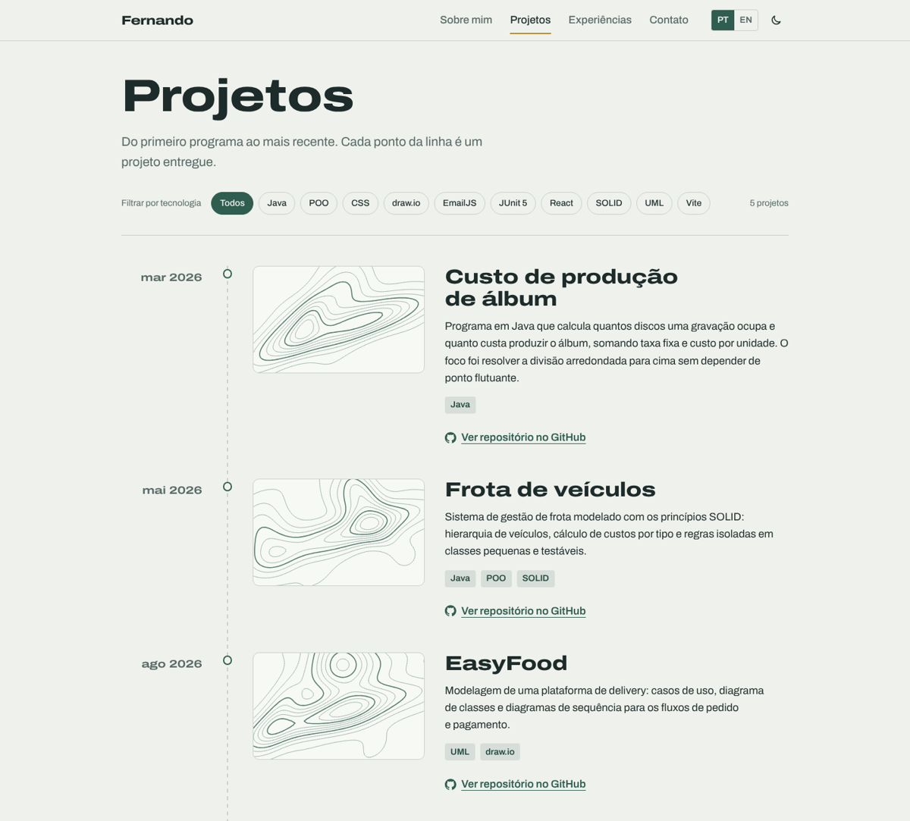
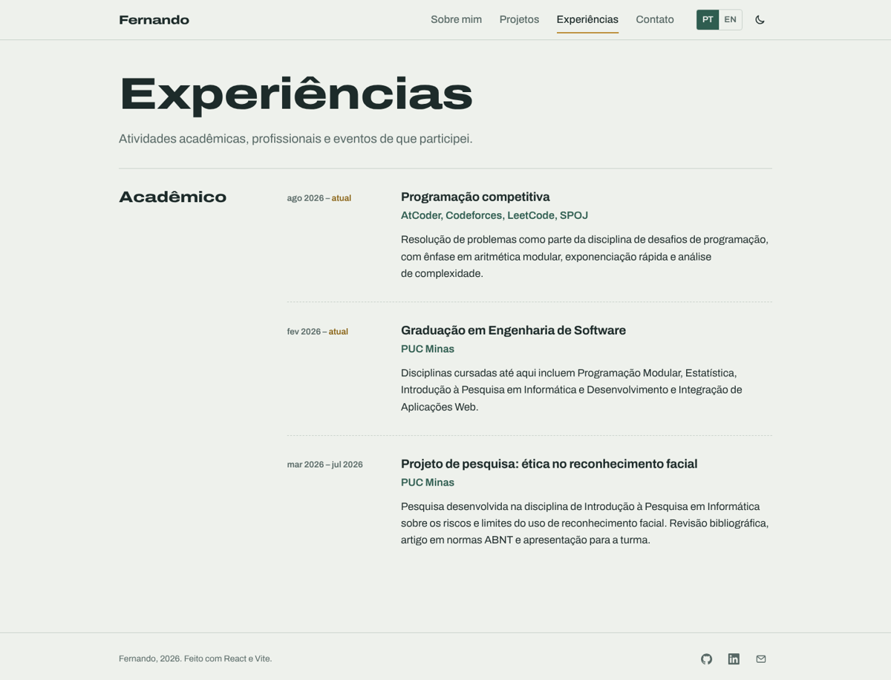
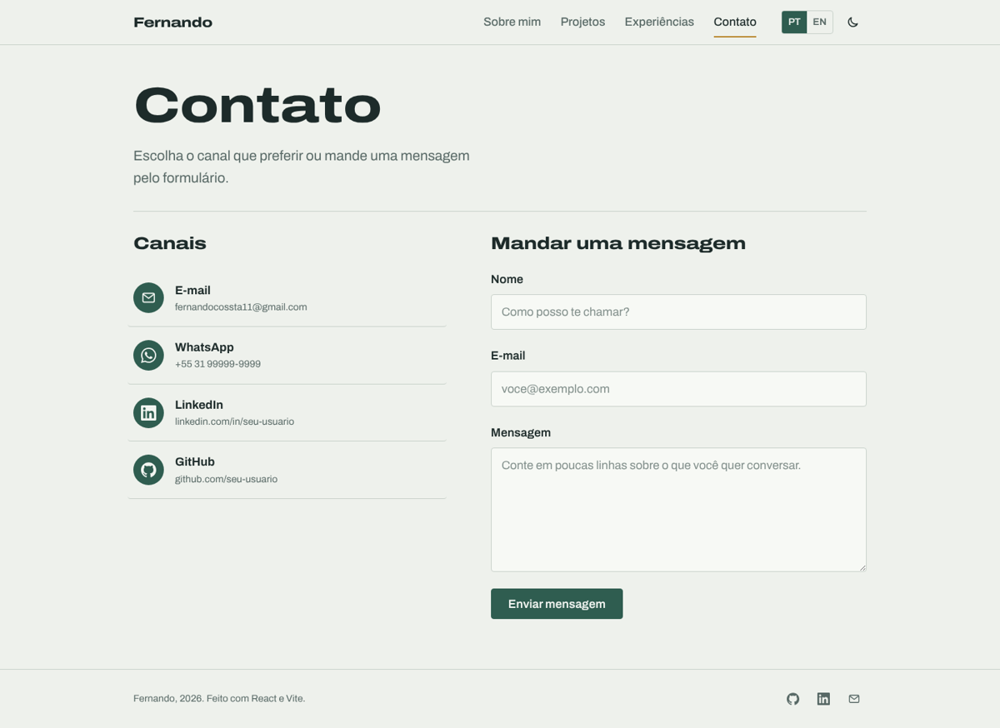
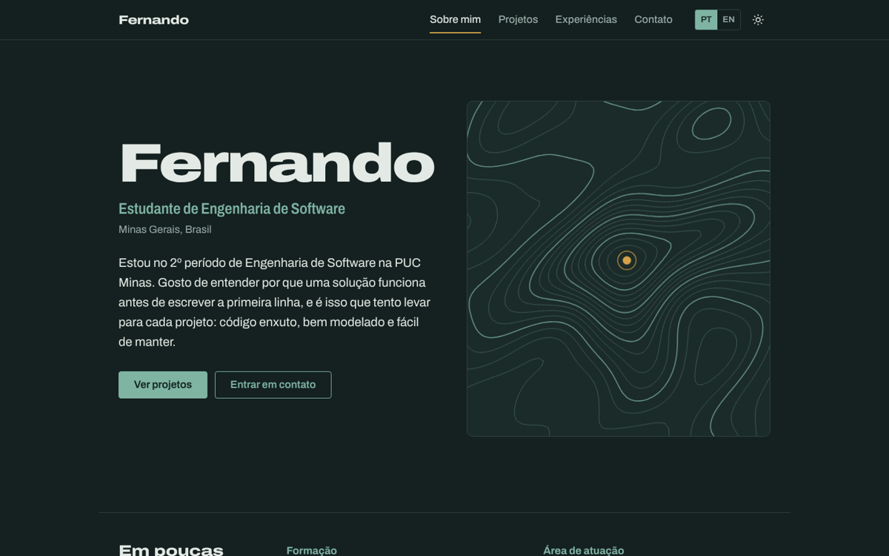
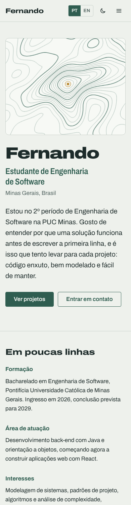

# 🏷️ Portfólio Profissional — Fernando 👨‍💻

> [!NOTE]
> Site de portfólio pessoal para apresentar minha trajetória, projetos, experiências e formas de contato, em português e inglês.
> Desenvolvido no **Laboratório 01** da disciplina **Desenvolvimento e Integração de Aplicações Web (DIAW)** — Engenharia de Software, PUC Minas.

<table>
  <tr>
    <td>
      A identidade visual parte de um elemento de Minas Gerais: as <b>curvas de nível</b> das serras.
      O mapa topográfico da página inicial é gerado por código a partir de um relevo sintético,
      e a mesma linguagem aparece na linha do tempo de projetos, onde cada projeto é um ponto da trilha
      e o mais recente é marcado como "onde estou agora".
    </td>
    <td width="220"></td>
  </tr>
</table>

---

## 🚧 Status do Projeto


| Sprint | Entrega | Status |
| --- | --- | --- |
| Lab01S01 | Planejamento, wireframes, protótipo, navegação e layout | 🟡 Em andamento |
| Lab01S02 | Funcionalidades principais (PT/EN, timeline, experiências, contato) | 🟡 Implementado localmente |
| Lab01S03 | Deploy, ajustes visuais, GIFs dos projetos e README final | ⚪ Pendente |

---

## 📚 Índice

- [Links Úteis](#-links-úteis)
- [Sobre o Projeto](#-sobre-o-projeto)
- [Funcionalidades Principais](#-funcionalidades-principais)
- [Tecnologias Utilizadas](#-tecnologias-utilizadas)
- [Arquitetura](#-arquitetura)
- [Protótipos e Wireframes](#-protótipos-e-wireframes)
- [Instalação e Execução](#-instalação-e-execução)
  - [Pré-requisitos](#pré-requisitos)
  - [Variáveis de Ambiente](#-variáveis-de-ambiente)
  - [Instalação de Dependências](#-instalação-de-dependências)
  - [Como Executar a Aplicação](#-como-executar-a-aplicação)
- [Como Editar o Conteúdo](#️-como-editar-o-conteúdo)
- [Deploy](#-deploy)
- [Estrutura de Pastas](#-estrutura-de-pastas)
- [Demonstração](#-demonstração)
- [Testes](#-testes)
- [Documentações utilizadas](#-documentações-utilizadas)
- [Autores](#-autores)
- [Contribuição](#-contribuição)
- [Agradecimentos](#-agradecimentos)
- [Licença](#-licença)

---

## 🔗 Links Úteis

- 🌐 **Demo Online:** [Acesse o site](https://seu-portfolio.vercel.app) <!-- TODO: trocar pelo link da Vercel após o deploy -->

> 💻 **Descrição:** site publicado em produção na Vercel.

- 📐 **Wireframes no Figma:** [Abrir protótipo](https://www.figma.com/) <!-- TODO: link do arquivo no Figma -->

> 🎨 **Descrição:** wireframes de média fidelidade das quatro páginas, desktop e mobile.

---

## 📝 Sobre o Projeto

**Por que existe.** Um currículo em PDF mostra o que a pessoa diz que sabe; um portfólio mostra o que ela já fez. Este site reúne meus projetos acadêmicos com links para o código, minhas experiências e um canal direto de contato, num endereço fácil de compartilhar em candidaturas a estágio.

**Que problema resolve.** Recrutadores e professores costumam ter poucos minutos para avaliar um estudante. O site organiza o essencial em quatro páginas curtas, com os projetos em ordem cronológica para mostrar a evolução, e permite enviar uma mensagem sem sair da página.

**Contexto.** Projeto acadêmico do Laboratório 01 de DIAW (2º período de Engenharia de Software, PUC Minas), desenvolvido em três sprints: planejamento e prototipação, implementação das funcionalidades e hospedagem na nuvem.

**Onde pode ser usado.** Link em perfis do LinkedIn e GitHub, em candidaturas a estágio e como base para evoluir o portfólio ao longo do curso: novos projetos e experiências entram editando apenas os arquivos de dados.

---

## ✨ Funcionalidades Principais

- 🧭 **Navegação por menu:** quatro páginas com rotas próprias (`/`, `/projetos`, `/experiencias`, `/contato`), cabeçalho fixo, rodapé e menu recolhível no celular.
- 🌐 **Internacionalização (i18n):** todo o conteúdo em português e inglês, com a escolha salva no navegador. O idioma inicial segue o do sistema.
- 🗺️ **Sobre mim:** apresentação, formação, área de atuação, interesses, objetivos e tecnologias.
- 📈 **Linha do tempo de projetos:** ordenada automaticamente do mais antigo ao mais recente, com nome, descrição, tecnologias, link do GitHub e imagem/GIF. Filtro por tecnologia.
- 💼 **Experiências:** agrupadas por tipo (profissional, open source, eventos, acadêmico), com instituição, cargo/atividade, período e descrição.
- 📨 **Contato:** ícones clicáveis para e-mail, WhatsApp, LinkedIn e GitHub, e formulário com validação (nome, e-mail, mensagem) que envia por e-mail via EmailJS, com resposta automática opcional para quem escreveu.
- 🌗 **Tema claro e escuro:** segue o sistema por padrão e pode ser alternado no cabeçalho.
- ♿ **Acessibilidade:** link "pular para o conteúdo", foco visível, rótulos ARIA, mensagens de erro associadas aos campos e respeito a `prefers-reduced-motion`.
- 📱 **Responsivo:** layout pensado a partir de 360px de largura.

---

## 🛠 Tecnologias Utilizadas

### 💻 Front-end

- **Biblioteca:** React 19
- **Linguagem:** JavaScript (ES2022+), JSX
- **Roteamento:** React Router 7
- **Formulários:** React Hook Form 7
- **Estilização:** CSS puro com CSS Modules e variáveis CSS (design tokens)
- **Tipografia:** Archivo (fonte variável com eixo de largura), servida localmente via Fontsource
- **Gerenciamento de Estado:** Context API (idioma) e hooks (tema)
- **Build Tool:** Vite 8

### 🖥️ Back-end

O site não tem servidor próprio. O envio de e-mail é feito pelo **EmailJS**, um serviço que recebe os dados do formulário direto do navegador e encaminha a mensagem para a minha caixa de entrada.

### ⚙️ Infraestrutura & DevOps

- **Cloud:** Vercel (hospedagem gratuita de sites estáticos)
- **Versionamento:** Git e GitHub

### 📦 Dependências

| Pacote | Versão | Uso |
| --- | --- | --- |
| `react` / `react-dom` | ^19.2 | Interface |
| `react-router-dom` | ^7.9 | Rotas entre as páginas |
| `react-hook-form` | ^7.66 | Estado e validação do formulário de contato |
| `@emailjs/browser` | ^4.4 | Envio de e-mail pelo front-end |
| `@fontsource-variable/archivo` | ^5.3 | Fonte hospedada junto com o site |
| `vite` *(dev)* | ^8.0 | Servidor de desenvolvimento e build |
| `@vitejs/plugin-react` *(dev)* | ^6.0 | Suporte a React/JSX no Vite |

---

## 🏗 Arquitetura

Aplicação **SPA (Single Page Application)** estática, organizada em camadas simples:

| Camada | Pasta | Responsabilidade |
| --- | --- | --- |
| Dados | `src/data/` | Conteúdo do site (perfil, projetos, experiências) em objetos JS com campos `{ pt, en }` |
| Textos da interface | `src/i18n/` | Rótulos, botões e mensagens nos dois idiomas, e o `LanguageContext` |
| Serviços | `src/services/` | Integração externa (EmailJS) |
| Componentes | `src/components/` | Peças reutilizáveis: cabeçalho, rodapé, layout, mapa topográfico, ícones |
| Páginas | `src/pages/` | Uma por rota; combinam dados e componentes |
| Estilos | `src/styles/` + `*.module.css` | Tokens globais e estilos isolados por componente |

**Decisões importantes**

- **Conteúdo separado do código.** Para adicionar um projeto ou experiência basta editar um arquivo em `src/data/`; nenhum componente precisa mudar. A ordem cronológica é calculada na página.
- **Tradução por dados.** Cada texto traduzível é um objeto `{ pt, en }` resolvido pela função `tr()` do contexto de idioma. Isso evita uma biblioteca de i18n para um site deste tamanho.
- **Sem back-end próprio.** O único requisito de servidor é enviar e-mail; o EmailJS atende isso sem custo de hospedagem e sem expor credenciais de SMTP (a chave usada no front-end é pública por design).
- **Mapa topográfico procedural.** As curvas de nível são calculadas no navegador com o algoritmo *marching squares* sobre um relevo gerado por uma semente fixa. O resultado é sempre o mesmo para a mesma semente, não depende de imagens e se adapta ao tema claro/escuro.
- **CSS Modules em vez de framework de UI.** Mantém o visual próprio e o bundle pequeno.

**Fluxo do formulário de contato**

```
Usuário preenche o formulário
        │
        ▼
React Hook Form valida (nome ≥ 2, e-mail válido, mensagem ≥ 10)
        │ ok
        ▼
services/email.js ──► EmailJS (template para mim) ──► minha caixa de entrada
        │
        └──────────► EmailJS (template de resposta automática, opcional) ──► quem enviou
```

**Trade-offs.** Por ser uma SPA, o conteúdo é renderizado no navegador; para um portfólio isso não é problema, mas buscadores indexam melhor páginas pré-renderizadas. Uma evolução possível é migrar para Next.js com geração estática.

---

## 📐 Protótipos e Wireframes

Wireframes de média fidelidade no Figma: **[link do Figma](https://www.figma.com/)** <!-- TODO -->

| Sobre mim | Projetos |
| --- | --- |
|  |  |
| **Experiências** | **Contato** |
|  |  |

> Exporte os frames do Figma como PNG para a pasta `docs/wireframes/` com os nomes acima.

---

## 🔧 Instalação e Execução

### Pré-requisitos

- **Node.js:** 20.19+ ou 22.12+ (exigência do Vite 8)
- **Gerenciador de pacotes:** npm (já vem com o Node)
- **Git**

### 🔑 Variáveis de Ambiente

Copie `.env.example` para `.env.local` na raiz do projeto e preencha com os dados do [painel do EmailJS](https://dashboard.emailjs.com).

| Variável | Descrição | Obrigatória |
| --- | --- | --- |
| `VITE_EMAILJS_SERVICE_ID` | ID do serviço de e-mail conectado no EmailJS | Sim |
| `VITE_EMAILJS_TEMPLATE_ID_FOR_ME` | Template da mensagem que chega para mim | Sim |
| `VITE_EMAILJS_TEMPLATE_ID_FOR_SENDER` | Template de resposta automática para quem enviou | Não |
| `VITE_EMAILJS_PUBLIC_KEY` | Chave pública da conta (Account > General) | Sim |

```env
VITE_EMAILJS_SERVICE_ID=seu_service_id_aqui
VITE_EMAILJS_TEMPLATE_ID_FOR_ME=seu_template_id_for_me_aqui
VITE_EMAILJS_TEMPLATE_ID_FOR_SENDER=seu_template_id_for_sender_aqui
VITE_EMAILJS_PUBLIC_KEY=sua_public_key_aqui
```

Nos templates do EmailJS, use as variáveis `{{name}}`, `{{email}}`, `{{message}}` e `{{time}}`. No template de resposta automática, configure o campo **To Email** como `{{email}}`.

> **Obs:** em projetos Vite as variáveis precisam começar com `VITE_` para ficarem disponíveis no código do navegador. Sem elas o site funciona normalmente, mas o formulário avisa que o envio não está configurado.

### 📦 Instalação de Dependências

```bash
git clone https://github.com/seu-usuario/portfolio.git
cd portfolio
npm install
```

### ⚡ Como Executar a Aplicação

```bash
npm run dev
```

🎨 *O site estará disponível em **http://localhost:5173**.*

Outros scripts:

| Comando | O que faz |
| --- | --- |
| `npm run build` | Gera a versão de produção na pasta `dist/` |
| `npm run preview` | Serve a pasta `dist/` localmente para conferir o build |

---

## ✏️ Como Editar o Conteúdo

| Quero mudar... | Arquivo |
| --- | --- |
| Nome, apresentação, formação, objetivos, tecnologias, links de contato | `src/data/profile.js` |
| Projetos da linha do tempo | `src/data/projects.js` |
| Experiências | `src/data/experiences.js` |
| Textos de botões, menus e mensagens | `src/i18n/strings.js` |
| Cores, fontes e espaçamentos | `src/styles/global.css` (bloco `:root`) |

**Imagens e GIFs dos projetos:** salve o arquivo em `public/projects/` e informe o caminho no campo `image` do projeto, por exemplo `image: '/projects/xulambs.gif'`. Enquanto `image` for `null`, o site mostra uma capa com curvas de nível gerada a partir do `id` do projeto.

---

## 🚀 Deploy

O site é publicado na **Vercel**.

1. Faça login em [vercel.com](https://vercel.com) com a conta do GitHub e clique em **Add New > Project**.
2. Importe o repositório. A Vercel detecta o Vite automaticamente:
   - **Build Command:** `npm run build`
   - **Output Directory:** `dist`
3. Em **Settings > Environment Variables**, cadastre as quatro variáveis `VITE_EMAILJS_*`.
4. Clique em **Deploy**. A cada `git push` na branch `main` um novo deploy é feito; pull requests ganham um link de *preview*.

O arquivo `vercel.json` redireciona todas as rotas para o `index.html`, para que endereços como `/projetos` funcionem ao recarregar a página.

---

## 📂 Estrutura de Pastas

```
.
├── .env.example                 # 🧩 Variáveis de ambiente necessárias (sem valores reais)
├── .gitignore                   # 🧹 Ignora node_modules, dist e arquivos .env
├── index.html                   # 📄 HTML base; aplica o tema salvo antes do React carregar
├── package.json                 # 📦 Dependências e scripts
├── vite.config.js               # ⚙️ Configuração do Vite
├── vercel.json                  # ☁️ Reescrita de rotas da SPA na Vercel
├── README.md                    # 📘 Esta documentação
├── LICENSE                      # ⚖️ Licença MIT
│
├── /docs
│   ├── /screenshots             # 🖼️ Capturas do site usadas no README
│   └── /wireframes              # 📐 Wireframes exportados do Figma
│
├── /public
│   ├── favicon.svg              # 🏷️ Logo/ícone do site
│   └── /projects                # 🎞️ Imagens e GIFs dos projetos
│
└── /src
    ├── main.jsx                 # 🚪 Ponto de entrada: Router, idioma, fonte e estilos globais
    ├── App.jsx                  # 🧭 Definição das rotas
    ├── /components              # 🧱 Componentes reutilizáveis
    │   ├── Layout.jsx           #     Estrutura comum: cabeçalho, conteúdo, rodapé
    │   ├── Header.jsx           #     Menu, seletor de idioma e de tema, menu mobile
    │   ├── Footer.jsx           #     Rodapé com redes
    │   ├── Icon.jsx             #     Ícones SVG inline
    │   ├── TopoMap.jsx          #     Mapa de curvas de nível
    │   ├── topo.js              #     Geração do relevo e marching squares
    │   └── ProjectCover.jsx     #     Imagem do projeto ou capa gerada
    ├── /pages                   # 📄 Uma página por rota
    │   ├── About.jsx            #     Sobre mim
    │   ├── Projects.jsx         #     Linha do tempo de projetos
    │   ├── Experiences.jsx      #     Experiências
    │   ├── Contact.jsx          #     Canais e formulário
    │   └── NotFound.jsx         #     Página 404
    ├── /data                    # 🗂️ Conteúdo do site
    │   ├── profile.js
    │   ├── projects.js
    │   └── experiences.js
    ├── /i18n                    # 🌎 Internacionalização
    │   ├── LanguageContext.jsx
    │   └── strings.js
    ├── /hooks
    │   └── useTheme.js          # 🌗 Tema claro/escuro
    ├── /services
    │   └── email.js             # 📨 Integração com EmailJS
    └── /styles
        └── global.css           # 🎨 Tokens, base e utilitários
```

---

## 🎥 Demonstração

### 🌐 Aplicação Web

| Página | Captura de Tela |
| --- | --- |
| **Sobre mim** |  |
| **Projetos** |  |
| **Experiências** |  |
| **Contato** |  |
| **Tema escuro** |  |
| **Mobile** |  |

---

## 🧪 Testes

Verificações feitas antes de cada entrega:

- `npm run build` sem erros nem avisos.
- Navegação entre as quatro rotas, recarregando a página em cada uma (rota direta) e acessando um endereço inexistente (página 404).
- Troca de idioma e de tema, conferindo que a escolha permanece ao recarregar.
- Formulário: envio vazio (três mensagens de erro), e-mail inválido, e envio válido com e sem as variáveis do EmailJS configuradas.
- Filtro de tecnologias na página de projetos.
- Layout em 360px, 768px e 1440px, e navegação somente pelo teclado.

---

## 🔗 Documentações utilizadas

- 📖 [Documentação oficial do **React**](https://react.dev/reference/react)
- 📖 [Guia do **Vite**](https://vite.dev/guide/)
- 📖 [**React Router**](https://reactrouter.com/)
- 📖 [**React Hook Form**](https://react-hook-form.com/docs)
- 📖 [**EmailJS** para navegador](https://www.emailjs.com/docs/sdk/installation/)
- 📖 [Deploy de projetos Vite na **Vercel**](https://vercel.com/docs/frameworks/frontend/vite)
- 📖 [Algoritmo **Marching squares**](https://en.wikipedia.org/wiki/Marching_squares)
- 📖 [**Conventional Commits**](https://www.conventionalcommits.org/pt-br/v1.0.0/)

---

## 👥 Autores

| 👤 Nome | :octocat: GitHub | 💼 LinkedIn | 📤 Gmail |
| --- | --- | --- | --- |
| Fernando | [seu-usuario](https://github.com/seu-usuario) | [LinkedIn](https://www.linkedin.com/in/seu-usuario) | [E-mail](mailto:fernandocossta11@gmail.com) |

---

## 🤝 Contribuição

1. Faça um `fork` do projeto.
2. Crie uma branch para sua alteração (`git checkout -b feature/minha-feature`).
3. Faça commit seguindo o [Conventional Commits](https://www.conventionalcommits.org/pt-br/v1.0.0/) (`git commit -m 'feat: adiciona projeto X na timeline'`).
4. Envie para o seu fork (`git push origin feature/minha-feature`).
5. Abra um **Pull Request**.

---

## 🙏 Agradecimentos

- [**Engenharia de Software PUC Minas**](https://www.instagram.com/engsoftwarepucminas/) — pelo apoio institucional e pela estrutura do curso.
- [**Prof. Dr. João Paulo Aramuni**](https://github.com/joaopauloaramuni) — pela proposta do laboratório e pelo template deste README.

---

## 📄 Licença

Este projeto é distribuído sob a **[Licença MIT](LICENSE)**.
